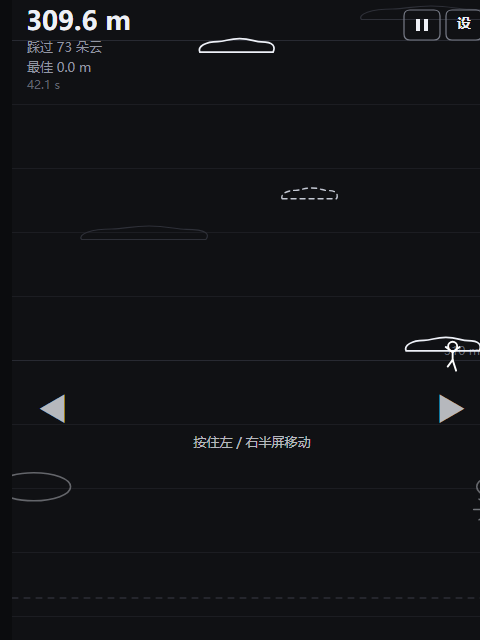

# CLOUD LADDER 云梯 — 手机版

踩云向上跳的极简线条小游戏，**手机浏览器直接打开就能玩**，不用装任何东西。

成品是一个**单文件**：[`dist/CloudClimb.html`](dist/CloudClimb.html)（约 54 KB，图标、样式、代码全部内嵌）。
传到手机上点开就能玩，也可以放在电脑浏览器里玩（同一份文件）。



## 怎么放到手机上

三种办法，任选：

**① 局域网直接打开（推荐，最像 App）**

电脑上运行：

```powershell
node mobile/serve.js
```

它会打印出几个地址，手机连同一个 WiFi、用浏览器打开其中那个 `http://192.168.x.x:8080/` 就行。
玩起来之后，用浏览器的「添加到主屏幕」把图标存下来，以后点图标即可**全屏**打开，
跟装了个 App 一样（游戏图标是内置生成的那朵云）。

**② 直接传文件**

把 `dist/CloudClimb.html` 用微信 / QQ 发到手机（或用数据线拷进去），
在手机上点开、选择「用浏览器打开」。整份游戏就在这一个文件里，断网也能玩。

**③ 电脑上先试玩**

双击 `dist/CloudClimb.html`，键盘 `←→`/`AD` 移动、`空格` 起跳、`S` 设置。

## 操作

手机版**只需要一根手指**：

| 操作 | 作用 |
| --- | --- |
| 点一下屏幕 | 从出生云起跳（只有开局这一次需要点） |
| 按住屏幕左半边 / 右半边 | 左右移动；手指可以左右滑着换边 |
| 右上角 `II` | 暂停 |
| 右上角 `设` | 设置（跳跃力度 / 重力），带 `−` `+` 按钮 |
| 点屏幕任意处 | 就绪 / 结算界面里用来开始或重开 |

玩法与桌面版完全一致：踩到云会**立刻消失并把角色弹起**，上升途中脚擦到云顶也算踩到，
**完全掉出屏幕底部就结束**。开局那一下起跳之后，你唯一要做的就是控制左右落点。

## 与桌面版的关系

两条线的**核心逻辑是同一套参数**（重力 1300、起跳初速 680、物理固定步长 240 Hz、
云间距按跳跃峰高的 56% ~ 84% 自适应……），所以手感和难度曲线是对齐的。

区别只在表现层：手机版是 Canvas 2D + 触屏，桌面版是 WinForms + 键盘。

## 文件结构

```
mobile/
├─ dist/CloudClimb.html   ← 成品（单文件，手机浏览器直接打开）
├─ src/engine.js          ← 核心逻辑：物理 / 云生成 / 踩云判定 / 相机
├─ src/shell.js           ← 界面层：Canvas 渲染 / 触屏输入 / 主循环 / 设置
├─ build.js               ← 打包成单文件 HTML（并生成内嵌 App 图标）
├─ serve.js               ← 局域网分享小服务器
├─ selfcheck.js           ← 核心逻辑自检（Node 跑）
├─ webcheck.js            ← 界面层冒烟测试（Node 跑，不需要浏览器）
└─ shots/                 ← 自检报告 + 无头浏览器截图
```

`src/engine.js` 写成了 UMD，**浏览器和 Node 共用同一份**。
所以下面两个自检脚本验证的就是手机里真正跑的那份代码，而不是复制品。

## 重新打包

```powershell
node mobile/build.js
```

会重新生成 `dist/CloudClimb.html`（含内嵌图标），并打印体积。

## 自检（开发用）

```powershell
node mobile/selfcheck.js     # 核心逻辑：跳跃弧线、云层可达性、AI 试跑
node mobile/webcheck.js      # 界面层：加载→开局→游戏→暂停→设置→结算 全流程冒烟
```

- `selfcheck.js`：三组极端跳跃参数 × 30 个种子做**可达性审计**，再用 AI 试跑 6 条命。
  最近一次：默认参数下 AI 平均爬到 **198 m / 49 朵云**，6 条命全部跑满 30 秒窗口；
  可达性审计 **0 对不可达**（最软参数 3030 对、默认 1500 对、最猛 540 对）。
- `webcheck.js`：在 Node 里搭一个极简的 Canvas / DOM 环境，把 `shell.js` 整份跑起来，
  从"画出来的文字"反推游戏状态。目前 **35 项全部通过**（含画布 dpr 缩放、
  各界面文案、触屏左右控制真的让角色位移、设置写入 localStorage 等）。

## 无头截图（开发用）

`CloudClimb.html` 支持几个调试参数，配合 Edge/Chrome 无头模式可以直接截到指定画面：

| 参数 | 作用 |
| --- | --- |
| `?autoplay=1` | 跳过加载页直接开局 |
| `&pad=left` / `&pad=right` | 模拟一直按住左 / 右半屏 |
| `&skip=42` | 开局后先同步快进 42 秒（无头模式里 rAF 几乎不触发，靠它才能截到爬升中的画面） |
| `?screen=settings` | 直接打开设置界面 |

```powershell
msedge --headless=new --disable-gpu --window-size=480,640 `
  --virtual-time-budget=1500 --screenshot=shot.png `
  "file:///.../mobile/dist/CloudClimb.html?autoplay=1&skip=42"
```

## 一些实现上的坑（免得以后重踩）

- **手机上没有跳跃键**：原本只有键盘能起跳，导致手机上站在出生云上永远起不来。
  现在改成「站在出生云上时点一下屏幕就起跳」，之后全靠自动弹起。
- **触点要监听在 window 上**：`pointerup` 如果只挂在 canvas 上，手指滑出画面就收不到，
  角色会一直往一个方向跑。另外还加了 `blur` 时清空触点作为保险。
- **画布按 dpr 放大**：`canvas.width = 480 × devicePixelRatio`（上限 2×），
  否则高分屏上线条会发糊。
- **高度刻度要躲开 HUD**：刻度文字原本画在左边，会和左上角的高度 / 踩云数叠在一起，
  已改到右侧并跳过顶部 60px。
